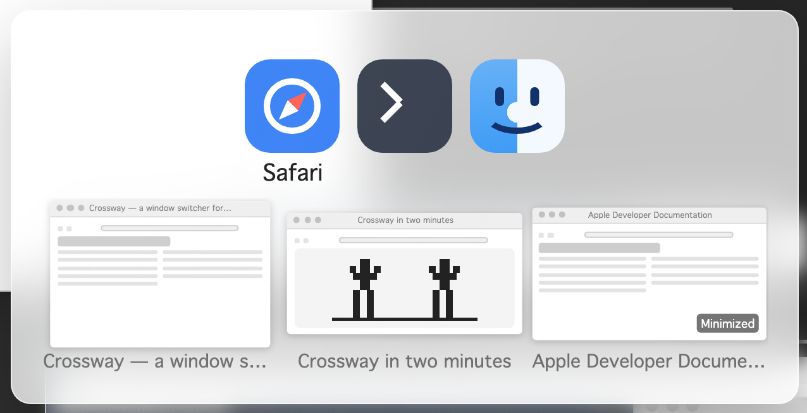

# Crossway

[](https://github.com/crossway-app/Crossway-Releases/releases/latest)

**Website: [crosswayapp.com](https://crosswayapp.com/)**

**A fast ⌘Tab window switcher for macOS.**

Crossway replaces the built-in app switcher with one that understands *windows*, not just apps:

- **⌘Tab**: switch apps exactly like the native switcher. Hold a beat longer and live thumbnail previews of the highlighted app's windows appear beneath it.
- **⌘`**: cycle through the *windows* of the highlighted app and jump straight to the one you want, without touching the trackpad.
- **⌥Tab / ⌥`**: an exposé-style grid of every open window (or just the current app's windows), with window titles and Dock badges.
- Keyboard-first, with full mouse support: hover to select, click to activate, arrow keys work on every surface.
- Quick taps behave exactly like native macOS. Crossway's UI only appears when you *hold* the shortcut.

That is the short version. [The full list of features](https://crosswayapp.com/features/) has every command, setting and privacy promise, with a link for each.



## Requirements

- macOS 14 to 26.
- Apple Silicon or Intel (the app is universal).

## Download

### [⬇️ Download the latest Crossway.zip](https://github.com/crossway-app/Crossway-Releases/releases/latest/download/Crossway.zip)

Or let an agent install it for you. Paste this into Claude Code, Codex, or another agent:

```
Install Crossway: https://crosswayapp.com/SKILL.md
```

Every build is signed with an Apple Developer ID certificate and notarized by Apple. Older versions and release notes are on the [Releases page](https://github.com/crossway-app/Crossway-Releases/releases).

**Always download in a web browser from this page.** Don't pass the zip around through chat apps. macOS won't open an app that a chat app saved. If that happens, the Troubleshooting section below shows how to fix it.

## Install

1. Unzip the download (double-click `Crossway.zip`).
2. Drag `Crossway.app` into your `/Applications` folder.
3. Open it. Crossway lives in the **menu bar**, so there is no Dock icon.
4. Grant the two permissions it asks for in **System Settings → Privacy & Security**:
   - **Accessibility**, to take over ⌘Tab and to raise the window you pick.
   - **Screen Recording**, for the window thumbnail previews.
5. Follow the in-app setup. In the final Startup choices, **Launch at login** starts
   on; **Auto-update** stays off unless you choose it. Crossway notices the grants
   and completes any required relaunch itself; you do not need to relaunch it manually.

## Privacy

Crossway doesn't record or upload anything. Nothing is saved to disk except your settings. Window previews live in memory only. There is no telemetry, and Crossway sends no identifiers.

Crossway only goes online to check GitHub for new versions. It checks when you ask it to, or on its own if you turn on **Auto-update**.

## Troubleshooting

**"The application “Crossway.app” can't be opened." (a plain dialog with only an OK button)**
This usually means the zip reached your Mac through a chat app, such as WhatsApp or Telegram. macOS won't open an app that a chat app saved. To open Crossway anyway, make sure it is in your Applications folder. Then open Terminal, which is in the Utilities folder inside Applications, paste this command, press Return, and open Crossway again:

```
xattr -r -d com.apple.quarantine /Applications/Crossway.app
```

Next time, download the zip from this page in your browser instead of through a chat app, and this won't happen.

**"Crossway is damaged and can't be opened."**
Your copy of Crossway was changed after it was downloaded, for example re-zipped or only partly copied, so macOS won't open it. To fix it, move Crossway from your Applications folder to the Trash, then download the zip again from this page in your browser.

**"Crossway can't be opened because Apple cannot check it for malicious software."**
On macOS 15 and later, this message reads "Apple could not verify “Crossway” is free of malware that may harm your Mac or compromise your privacy." Your copy of Crossway was changed after it was downloaded, for example re-zipped by another app or service, so macOS can't confirm it is the real one. To fix it, move Crossway from your Applications folder to the Trash, then download the zip again from this page in your browser.

**"Crossway requires macOS 14.0 or later."**
Crossway runs on macOS 14 Sonoma to macOS 26 Tahoe, and this Mac has an older version of macOS. If your Mac can be updated, open **System Settings → General → Software Update** (on macOS 12 or earlier, **System Preferences → Software Update**). When the update is done, open Crossway again. Crossway can't run on an older version.

**"Crossway was not downloaded from the App Store."**
Your Mac is set to open apps from the App Store only. To allow Crossway, open **System Settings → Privacy & Security** and scroll down to Security. On macOS 15 and later, set "Allow applications from" to **App Store & Known Developers**. On macOS 14, set "Allow applications downloaded from" to **App Store and identified developers**. Then open Crossway again.

## Which version am I running?

- **To find the version of a download:** the release title on this page shows it, for example *Crossway 2.0*. Each release also has a copy of the zip named with its version, like `Crossway-2.0.zip`.
- **To find which version you have:** click the Crossway icon in the menu bar and choose **Settings**. Your version is shown at the bottom of the Settings window. You can also select Crossway in your Applications folder and press ⌘I. The version is listed in the window that opens.
- **To check if you have the latest version:** click the Crossway icon in the menu bar and choose **Check for Updates**. Crossway tells you whether you have the latest version. If a newer one is out, it offers to download it in your browser. The **Check now** button in **Settings → General**, under Startup and updates, does the same.
- **To have Crossway check for you:** click the Crossway icon in the menu bar and choose **Settings**. On the General tab, turn on **Auto-update** under Startup and updates, and choose how often it checks. It is off until you turn it on. When a newer version is out, Crossway tells you, and you download it in your browser yourself.

## Terms

Crossway is free to use. The source code is private, and this page is the only official download location, so please link people here rather than re-hosting the zip.
